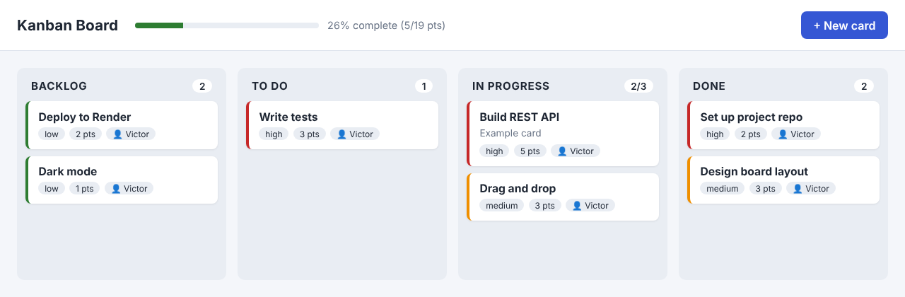

# Kanban Board


A lightweight Kanban board for running agile work, built with **Python (Flask)** and **SQLite**, with a vanilla JavaScript front end.

I built it to put the agile practices from my project management studies into working software: a work-in-progress limit, story points and sprint progress tracking.



## Features

- **Four columns:** Backlog → To Do → In Progress → Done.
- **Drag and drop** to move cards between columns and reorder them within a column.
- **WIP limit:** In Progress holds a set number of cards (3 by default), and the API enforces it, not just the front end.
- **Story points and progress bar:** shows how much of the sprint is complete, by points.
- **Card details:** priority (colour-coded), assignee, due date with an overdue warning, and a description.
- **REST API** with validation and clear JSON error messages.
- **Tested:** a pytest suite that runs on GitHub Actions with every push.

## Getting started

```bash
git clone https://github.com/volaitan/kanban-board.git
cd kanban-board
python -m venv .venv && source .venv/bin/activate   # Windows: .venv\Scripts\activate
pip install -r requirements.txt
python run.py
```

Then open http://127.0.0.1:5000. The SQLite database is created automatically in `instance/`.

Run the tests:

```bash
pytest -v
```

## API

| Method | Endpoint | Description |
|--------|----------|-------------|
| GET    | `/api/cards` | List all cards |
| POST   | `/api/cards` | Create a card (`title` required) |
| PATCH  | `/api/cards/<id>` | Update title, description, priority, assignee, points or due date |
| POST   | `/api/cards/<id>/move` | Move to `{ "status": "...", "position": n }` |
| DELETE | `/api/cards/<id>` | Delete a card |
| GET    | `/api/stats` | Cards and points per column, plus % complete |

Moving a card into a full In Progress column returns **409 Conflict**.

## Project structure

```
kanban/
├── __init__.py      # App factory and config (WIP_LIMIT)
├── db.py            # SQLite connection and schema
├── routes.py        # Page route, JSON API, validation, WIP rule
├── templates/index.html
└── static/          # app.js (rendering, drag and drop), style.css
tests/test_api.py    # pytest suite
run.py               # Development server
```

## Ideas for next steps

- User accounts and multiple boards
- Sprints with start and end dates and a burndown chart
- Deployment to Render or PythonAnywhere

## Licence

MIT
